<p align="center">
  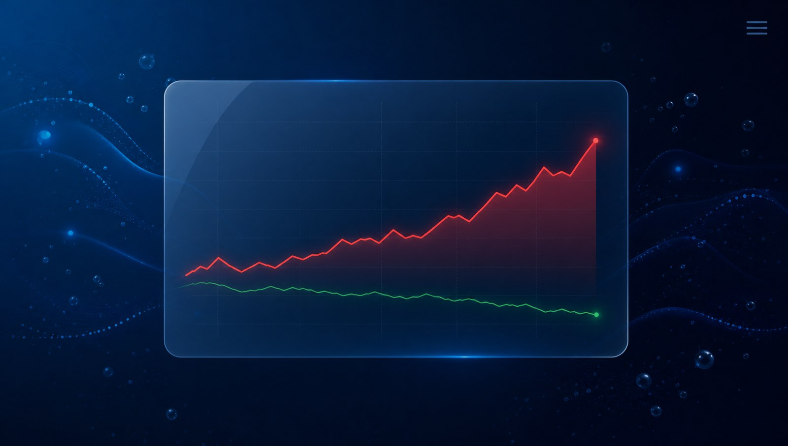
</p>

# QDII 估值 · 美股基金实时估值

> 把持有的 QDII / 美股指数基金，按「美股实时行情 → 汇率 → 净值滞后链」估出**今天的净值涨跌**，
> 并折算成人民币金额。菜单栏卡片常驻，三 Tab 看基金 / 个股 / 大事。

[](https://github.com/ogj130/stock-dashboard/actions/workflows/build.yml)
[](#测试)
[](https://nodejs.org)

## 它解决什么问题

QDII 的官方净值 **T+1/T+2** 才披露，白天看基金 App 永远显示昨天的数；而底层美股、汇率今天就在跳。
这个工具把两者接起来：用持仓成分的实时涨跌 + 汇率，估算「今天收盘后官方净值大概会是多少」，
并把滞后那几场按复合而不是相加补上。

- **净值滞后链**：官方净值日之后走完的每一场都按复合补进来（两场 +3% 是 +6.09%，不是 +6%）。
- **分相位口径**：盘前 / 盘中 / 收盘后 / 夜盘四段分开算，绝不拿昨天收盘当"现在"。
- **指数基金走官方口径**：跟踪 NDX 的基金用指数官方涨跌幅，盘前用代理 ETF（QQQ/SPY）。
- **对账**：拿官方净值与历史估算现算 MAE / bias（`/api/accuracy`），告诉你这套估算准不准、要不要调仓位系数。

## 界面

### 完整页面

<p align="center">
  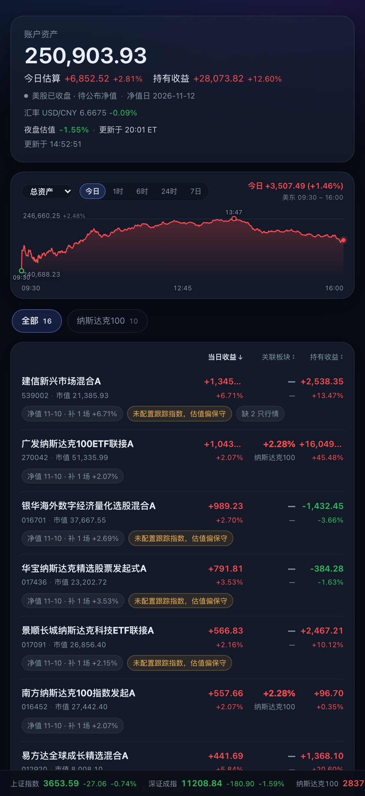
</p>

汇总卡回答「今天大概赚多少」：今日估算金额 + 百分比、持有收益、相位（盘前/盘中/已收盘）、
汇率、夜盘估值。曲线可以切「总资产 / 当日收益 / 持有收益」，三个指标都带百分比。

宽屏（≥980px）是两栏：左边汇总 / 曲线 / AI / 录入，右边基金列表；手机和平板保持单列。

<p align="center">
  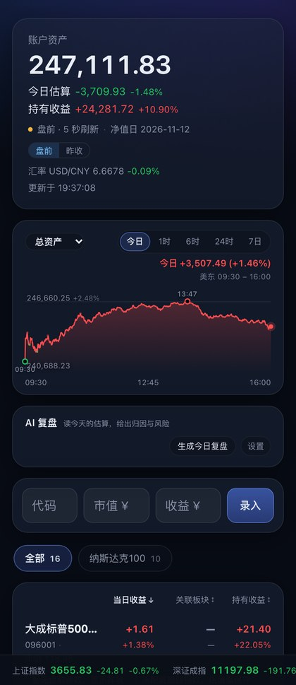
</p>

### 展开一只基金

<p align="center">
  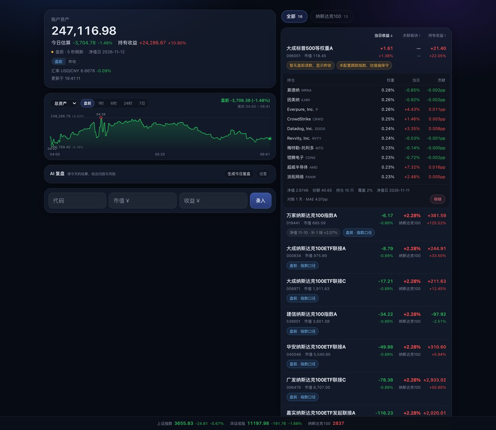
</p>

点任意一行展开：成分股逐只列出权重、当日涨跌与**对净值的贡献（pp）**，
底部给出覆盖率、份额、净值日、补了几场、对账 MAE。哪一个数字是怎么来的，都能追。

### 菜单栏卡片（`?compact=1`）

<p align="center">
  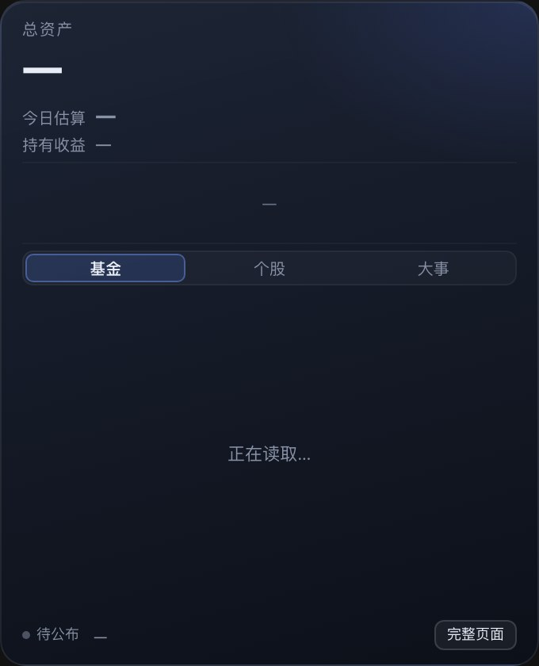
  &nbsp;&nbsp;
  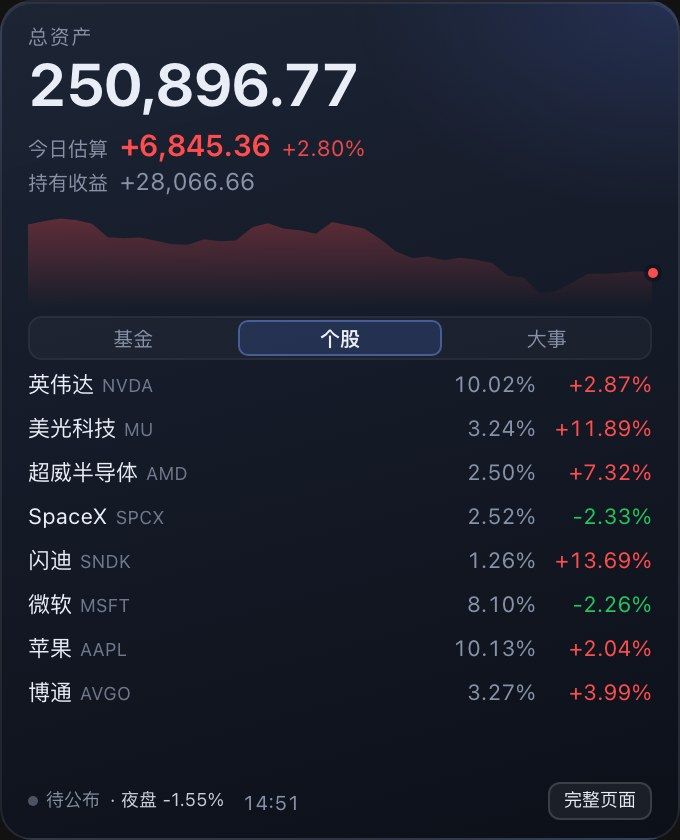
  &nbsp;&nbsp;
  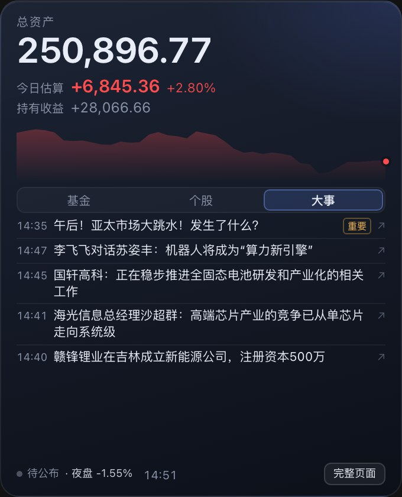
</p>

340×420 的置顶玻璃卡，三个 Tab：

| Tab | 看什么 |
|---|---|
| 基金 | 每只基金今日估算涨跌幅与金额，按金额降序 |
| 个股 | 所有基金共同持仓聚合出的重点个股，按**当日成交额（热度）**排序，显示组合权重与涨跌 |
| 大事 | 东财 7×24 快讯，重要事件优先；命中持仓股名的标「持仓」；点整行用系统浏览器打开原文 |

### AI 复盘（可选）

<p align="center">
  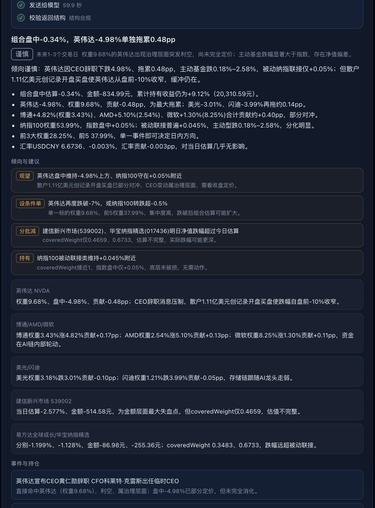
</p>

<p align="center">
  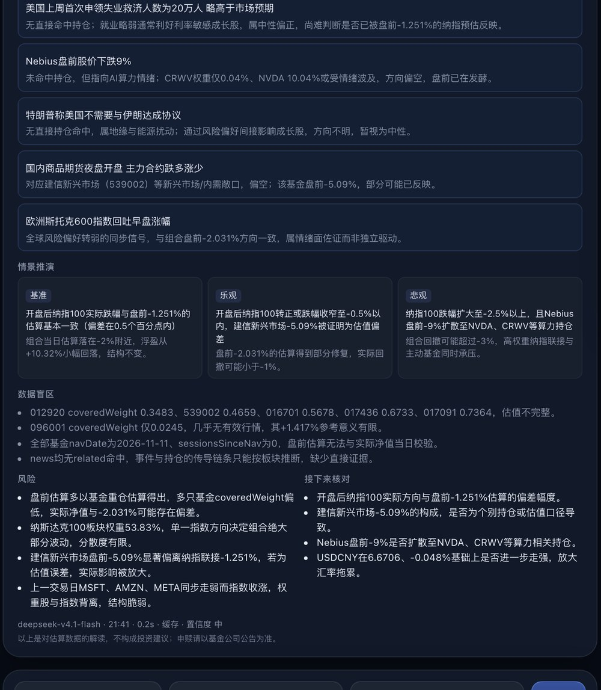
</p>

<p align="center">
  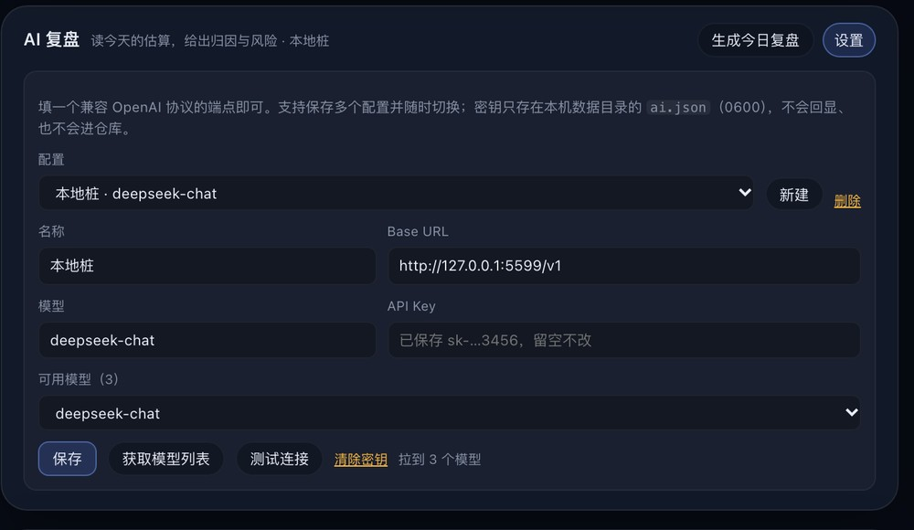
</p>

汇总卡下方有一块「AI 复盘」。点「设置」填 **Base URL / 模型 / API Key**（任何兼容 OpenAI 的
`/chat/completions` 端点都行），或者用环境变量 `AI_BASE_URL` / `AI_MODEL` / `AI_API_KEY`。

- 支持保存**多个配置**（名称 / Base URL / 模型 / 密钥），下拉切换「当前使用」；
  「获取模型列表」会打端点的 `/models`，拉到的模型可以直接选；
- 密钥写在数据目录的 `ai.json`（0600），不落库、不进仓库，接口只回掩码；
- 快照带**北京/美东时间与阶段**：盘前时明确标注指数与个股属于「上一交易日收盘」，
  不会把上一场涨幅当成今天盘前；净值日、补了几场也一并给模型；
- **事件归因**：快讯标题与持仓个股/板块做匹配，单独输出「事件与持仓」；
- **研究框架**：用预算好的贡献 pp、集中度（前 3/前 5 权重）、覆盖率与汇率影响做归因，
  再给出基准/乐观/悲观三档情景（各带触发条件）、数据盲区与置信度。框架参考了
  [trading-analysis-skill](https://github.com/GrantDeng/trading-analysis-skill) 的
  「多空对抗 + 风险校验」结构和 [skill-financial-analyst](https://github.com/geogons/skill-financial-analyst)
  的分层评分思路，按本系统只有估值快照的边界做了裁剪；
- 按需触发，结果缓存 10 分钟，不跟 5 秒行情一起跑，没配端点时整块只显示设置入口；
- 推理型模型（先输出思考）也支持：默认 4096 token，遇到截断会自动翻倍重试一次；
- 生成时有一块「处理过程」：整理快照（多少只基金/个股/快讯）→ 发送给模型（端点与模型名）
  → 校验结构，带实时耗时；失败时把出错的那一步标出来。

<p align="center">
  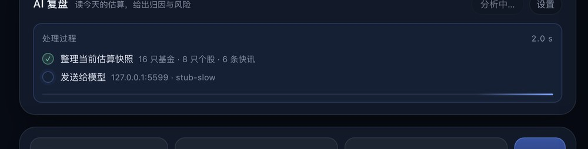
</p>
- 输出包含「结论 + 倾向判断（偏多/偏空/中性/谨慎，带时间尺度）+ 条件化建议（观望/持有/
  分批减/设条件单等，必须写触发条件与依据）」；这是基于估算的研判，不是收益承诺，
  界面始终附免责声明；
- 模型只能引用快照里的数字；快照只含基金代码/名称/金额/权重/涨跌与快讯标题，
  不含账户身份信息。模型返回不合约定结构时整块降级，不影响估值。

## 估值口径（改代码前先读这三条）

1. **QDII 净值滞后**：市值必须按滞后链复合（`src/engine/pipeline.ts` 的 `navChain`），不能只看当天。
2. **跟踪指数的基金**：常规时段用官方指数涨跌幅，盘前用代理 ETF（QQQ/SPY），不用成分自算。
3. **对账对齐**按「这场之后第 slot 次公布」，不能按自然日 +N（周末必错，见 `src/engine/reconcile.ts`）。

百分比的分母统一是**变动前基准**（`web/format.ts` 的 `pctFromDelta`）：
后端满足 `marketValue = 基准 × (1 + pct)`、`amount = 基准 × pct`，所以 `amount / (现值 − amount)`
能还原出真实涨跌幅。拿现值当分母会让涨的日子偏小、跌的日子偏大。

## 快速开始

### 直接下载

- **macOS（Apple Silicon）**：`QDII-24.18.0-mac-arm64.dmg` —— 自带 node，拖进 Applications 即可，
  双击起服务并打开浏览器；另含菜单栏卡片 `StockCard.app`。
- **Windows（x64）**：`QDII-24.18.0-win-x64.zip` —— 绿色版，解压双击 `start.bat`。

从 [Releases](https://github.com/ogj130/stock-dashboard/releases/latest) 直接下载；
每次 push 的临时产物在 [Actions](https://github.com/ogj130/stock-dashboard/actions/workflows/build.yml)
的 Artifacts 里（打 `v*` 标签会自动发 Release）。**未签名未公证**，macOS 首次打开需右键 → 打开。

### 本地开发

```bash
pnpm install
pnpm dev          # 后端：http://127.0.0.1:5178（tsx watch）
pnpm dev:web      # 前端：Vite 热更（另开一个终端）
pnpm test         # vitest，492 条
pnpm typecheck
```

### 改完之后一键重载（macOS）

```bash
pnpm reload       # 构建前端 → 重启后端（launchd）→ 重编/重拉菜单栏卡片
```

常驻服务交给 launchd（登录即起、退出即拉）：

```bash
./tools/dev/install-launchd.sh
launchctl print gui/$(id -u)/local.qdii.server
tail -f ~/Library/Logs/qdii-server.log
```

### 手机看

```bash
pnpm dev -- --lan    # 或 LAN=1 pnpm dev
```

默认只监听 `127.0.0.1`；开 `--lan` 会生成一次性口令链接（`?token=...`），首次访问后写 Cookie。
口令存在数据目录的 `access-token.txt`，同一 Wi-Fi 的人拿到口令就能看持仓——用完记得关。

## 数据与隐私

- 数据只在本机 SQLite：开发时 `data/app.db`（存在时优先），否则
  macOS `~/Library/Application Support/QDII/app.db`、Windows `%APPDATA%\QDII\app.db`。
- 没有任何上报、没有账号体系；备份就是复制这个文件。
- 如果启用了 AI 复盘，配置（含密钥）单独存在同目录的 `ai.json`（0600），不写进数据库。
- 行情全部是公开接口，且**不是官方 API**，随时可能变：

| 用途 | 来源 |
|---|---|
| 常规行情 | 东财 → 腾讯 → CNBC → 新浪（梯队 + 主备偏差裁决） |
| 汇率 | 东财 USD/CNH |
| 指数条 | 东财（`100.NDX100`），新浪备源 |
| 盘前 | CNBC `ExtendedMktQuote`，新浪兜底 |
| 夜盘 | 新浪盘后行情 |
| 快讯 | 东财 7×24 快讯 |

## 打包与 CI

| 命令 | 产物 |
|---|---|
| `./tools/mac/build-dmg.sh` | `dist-mac/QDII-24.18.0-mac-arm64.dmg`（自带 arm64 node + 前端 + 卡片） |
| `bash tools/win/build-win.sh` | `dist-win/QDII-24.18.0-win-x64.zip`（自带 node.exe，绿色版） |

两个脚本都会**用包里的运行时真起一次服务**，断言 `/`、`/assets/*.js`、`/api/health` 全 200，
再检查包里没有 `*.db` / 口令文件——只看「打包成功」发现不了 404 这种事故。

CI（[build.yml](.github/workflows/build.yml)）：

- push / PR → `typecheck` + `vitest`；
- push main → macOS（`macos-15`，arm64）出 DMG、ubuntu 出 Windows zip，产物挂 Artifacts；
- 打 `v*` 标签 → 自动建 Release，附上两个包。

## 目录结构

```
src/
  sources/      行情源（东财/腾讯/新浪/CNBC）、汇率、指数、盘前、夜盘、快讯
  engine/       估值链路：相位 → 滞后链 → 成分加权 → 对账
  store/        SQLite（节点快照、净值、对账样本）与备份
  routes/       /api/estimate、/api/portfolio、/api/funds、/api/accuracy、/api/news
  ai/           AI 复盘的配置、快照校验与提示词（OpenAI 兼容端点）
  net/          局域网口令与访问控制
web/            React 19 手写界面（无 UI 框架、无图表库，SVG 自己画）
tools/
  mac-card/     菜单栏卡片（Swift + WKWebView，无第三方依赖）
  mac/          DMG 打包
  win/          Windows 绿色版打包
  dev/          launchd、一键重载
tests/          vitest（引擎 / 路由 / 数据源解析 / 前端纯函数）
```

## 测试

```bash
pnpm test          # 492 passed（含两条默认 skip 的真实外网用例）
NET=1 pnpm test    # 连真实东财接口（需要外网）
```

测试完全不碰 `data/app.db`：需要库时用 `DB_PATH=/tmp/xxx.db`。

## 免责声明

这是个人自用的估值工具，不是投资建议，也不保证与官方净值一致。行情与快讯来自公开接口，
可能延迟、出错或失效；估算值仅用于盘中心里有数，申赎与对账请以基金公司公告为准。
